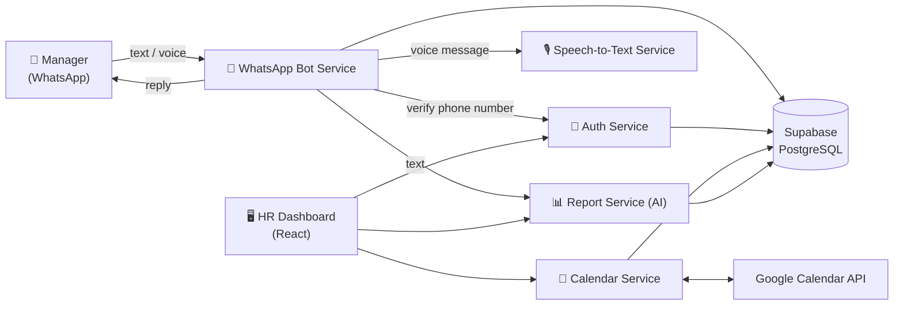

# Sola — Smart Insights for Employee Management

Sola is a full-stack, multi-service platform that lets managers track employee performance, sync meetings from Google Calendar, and generate AI-powered reports — including by sending a **WhatsApp text or voice message** to the Sola bot.

Built as a team project at **DiversiTech** (June–July 2026).

🔒 The production system is internal and available to company employees only. See the demo videos below for a full walkthrough.

---

## 🎬 Demo

**HR Dashboard & WhatsApp bot**

https://github.com/user-attachments/assets/5d588ee0-5032-4019-b96b-6af124e435cc

**Employee calendar access flow (manager request → email approval → meetings on the dashboard)**

https://github.com/user-attachments/assets/cc60ea9b-9a95-4d8c-9a98-c17c9f201c00

## 🏗️ Architecture



| Service | Responsibility |
|---|---|
| `WhatsApp-bot-service` | Receives WhatsApp messages via Meta webhook, routes them to the right service, replies to the user |
| `auth-service` | Login with email/password and Google / Facebook / Apple OAuth, user verification |
| `speach-to-text-service` | Transcribes voice messages to text |
| `report-service` | Analyzes messages with AI and produces employee reports |
| `calendar-service` | Google Calendar sync, access requests by email, meeting insights |
| `dashboard/client` | HR dashboard: employees, reports, meetings, permissions |

---

## 👩‍💻 My Contribution — WhatsApp Bot Service

I designed and built the **WhatsApp Bot Service**, the entry point that connects managers on WhatsApp to the rest of the system:

- **Meta WhatsApp Cloud API integration** — webhook verification, receiving incoming messages, and sending replies through the Graph API
- **Service orchestration** — calls the Auth, STT and Report services over REST and returns a response to the user in the chat
- **Text and voice handling** — text goes straight to the Report Service; voice notes are downloaded from Meta and sent to the Speech-to-Text Service first
- **Multilingual replies** — detects the language of the incoming message and answers in the same language
- **Message tracking** — logs every incoming message and its handling status (`PENDING` → done/failed) in Supabase, using a repository layer
- **Deployment** — configured the service for Render (`render.yaml`) and fixed production build issues

Code: [`WhatsApp-bot-service/`](./WhatsApp-bot-service)

---

## 🛠️ Tech Stack

- **Frontend:** React · TypeScript · Vite · Tailwind CSS · Radix UI · Recharts · React Router
- **Backend:** Node.js · Express · TypeScript · microservices over REST
- **Database:** Supabase (PostgreSQL)
- **Auth:** Passport.js (Google, Facebook, Apple OAuth) · JWT · sessions
- **AI:** OpenAI API (speech-to-text) · Google Gemini (report analysis)
- **Integrations:** Meta WhatsApp Cloud API · Google Calendar API
- **DevOps:** Render · Netlify / Cloudflare Pages · GitHub Actions (CI/CD)
---

## 🚀 Running Locally

Each service runs on its own. Example for the WhatsApp bot:

```bash
cd WhatsApp-bot-service
npm install
cp .env.example .env   # fill in your Meta, Supabase and service URLs
npm start
```

The dashboard:

```bash
cd dashboard/client
npm install
npm run dev
```

> Running the full system requires your own Meta WhatsApp, Supabase, Google Cloud and AI API keys. See each service's `.env.example`.

---

## 👥 Team

Developed as a team project at **DiversiTech**, with each team member owning a different service.
Original repository: [diversi-tech/sola](https://github.com/diversi-tech/sola)
